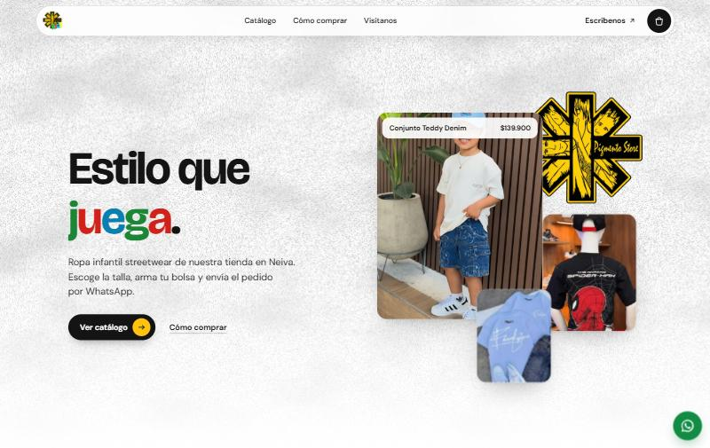
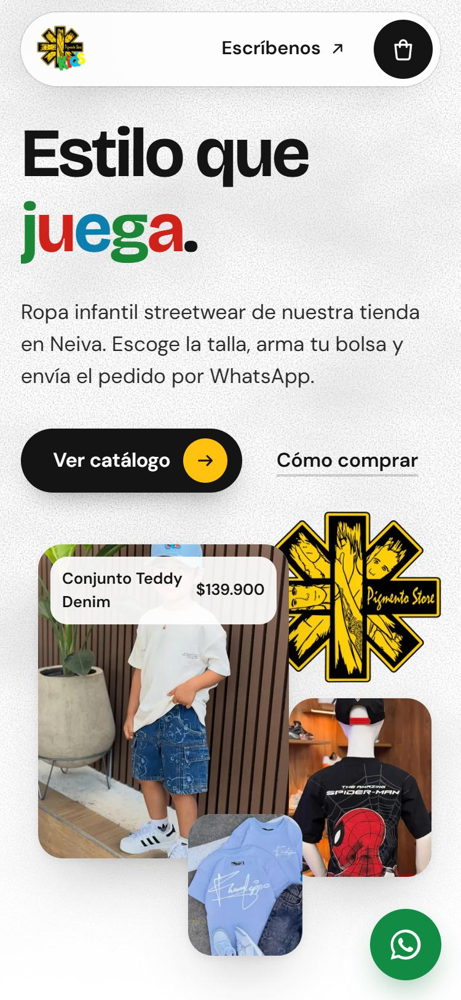
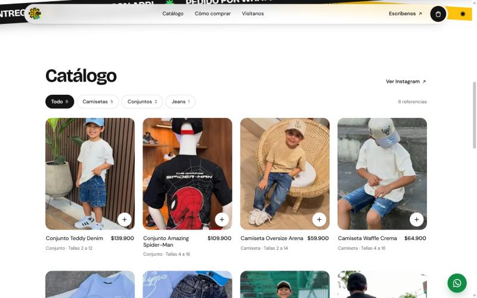

# Pigmento Store Kids

Catálogo web de ropa infantil streetwear de **Pigmento Store Kids** (Neiva, Huila, Colombia). El cliente escoge prenda, talla y color, arma su bolsa y envía el pedido ordenado por **WhatsApp**. No hay pasarela de pago.

Sitio estático (HTML, CSS y módulos JS nativos): sin compilación y sin dependencias de instalación.

| Escritorio | Móvil |
|---|---|
|  |  |



## Qué incluye

- Introducción animada del emblema (se puede saltar y respeta la preferencia de movimiento reducido).
- Catálogo de 8 referencias con filtros por categoría.
- Ficha de producto con color, talla y cantidad, y validación antes de agregar.
- Bolsa que se conserva al recargar, con cantidades editables y total de referencia.
- Pedido por WhatsApp con producto, talla, color, cantidad y total.
- Diseño responsive pensado primero para móvil.

## Estructura

```
site/                     ← carpeta que se publica
├── index.html            Estructura de la página
├── styles.css            Estilos
├── assets/
│   ├── logo/             Emblema, letras KIDS, favicon e imagen para compartir
│   └── products/         Fotos: <id>.webp (640×800) y <id>-sm.webp (320×400)
├── data/                 Información comercial (lo que se edita a diario)
│   ├── config.js         WhatsApp, Instagram, dirección, moneda
│   ├── products.js       Categorías y productos
│   └── product-schema.js Forma única de un producto y sus variantes
└── js/
    ├── main.js           Conecta datos, carrito e interfaz
    ├── catalog/          repository.js (acceso a datos) · product.js (reglas de variantes)
    ├── cart/             cart.js (operaciones) · pricing.js (totales) · storage.js (persistencia)
    ├── orders/           whatsapp.js (mensajes y enlaces wa.me)
    ├── ui/               intro, portada, catálogo, ficha, bolsa, efectos y capas modales
    └── lib/              utilidades (DOM, formato de dinero)
docs/screenshots/         Capturas del README
PRODUCT.md                Contexto de producto y datos por confirmar
FUTURE-ROADMAP.md         Evolución propuesta a tienda administrable (no implementada)
CLAUDE.md                 Instrucciones de trabajo del proyecto
```

Flujo de datos: `data/` → `catalog/repository.js` → `ui/`. La interfaz nunca lee `data/products.js` directamente. El carrito no conoce la interfaz y el mensaje de WhatsApp se arma solo en `orders/whatsapp.js`.

## Qué editar

| Quiero… | Dónde |
|---|---|
| Cambiar el número de WhatsApp | `site/data/config.js` → `whatsapp` (formato `573125414403`, sin `+`) y `whatsappLabel` |
| Agregar o modificar un producto | `site/data/products.js` (usa `defineProduct`) |
| Cambiar precio, tallas o colores | El mismo producto en `products.js`. Las variantes talla × color se generan solas |
| Marcar un dato como confirmado | `confirmed: true` en el producto (desaparece "Precio de referencia") |
| Precio tachado de comparación | `compareAtPrice: 129900` en el producto |
| Ocultar un producto | `active: false` |
| Marcar una talla como agotada | Define `variants` a mano con `availability: "out_of_stock"` (ver `product-schema.js`) |
| Agregar fotos | Copiar `<id>.webp` y `<id>-sm.webp` a `site/assets/products/` |
| Dirección, Instagram, mapa | `site/data/config.js` |

Todos los productos tienen `availability: "unconfirmed"` y `stock: null`: **no hay inventario real** y la tienda confirma la disponibilidad por WhatsApp. No se descuenta nada.

## Ejecutar y desplegar

Como usa módulos nativos, abre el sitio con un servidor local (no con doble clic al archivo):

```bash
npm run dev
```

Equivale a `npx http-server site -p 5173 -c-1`; abre <http://localhost:5173>. No hay build: se publica la carpeta `site/` tal cual.

- **Netlify:** `netlify.toml` (publish = `site`).
- **Vercel:** `vercel.json` (outputDirectory = `site`), framework *Other*, sin comando de build.
- **Cloudflare Pages:** sin comando de build, directorio de salida `site`.

`site/_headers` define la caché en Netlify y Cloudflare Pages. Con dominio definitivo, hay que volver absoluta la URL de `og:image` en `site/index.html` y agregar `<link rel="canonical">`.

## Estado y pendientes

- **Por confirmar con el cliente:** precios, descripciones, tallas, colores y disponibilidad de las 8 referencias. Hoy son provisionales y así se indica en la ficha ("Precio de referencia").
- **Fotos:** vienen del Instagram de la tienda (640 px). Para mejor calidad hacen falta fotos originales del cliente.
- **Administración:** el catálogo es de solo lectura. Base de datos, login, panel y carga de fotos están descritos en [FUTURE-ROADMAP.md](FUTURE-ROADMAP.md); no hay nada de eso instalado.

## Ramas

- `main`: rama estable.
- `develop`: trabajo en curso; todo cambio entra aquí primero.

## Tecnologías

HTML, CSS y JavaScript (módulos ES). [GSAP 3.12](https://gsap.com) desde cdnjs para las animaciones y Google Fonts (Bricolage Grotesque y DM Sans). Sin frameworks ni servicios de pago.

Proyecto a medida para Pigmento Store Kids.
